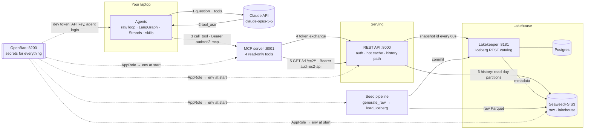

# learn-ai-agent

A hands-on course in **production MCP servers and AI agents**, built around a familiar data stack:
EC2 `describe-instances` snapshots → Iceberg on S3 → a REST API → an MCP server → agents you can ask
*"tell me about instance i-…, which region and what status?"* or *"what's the largest instance running in account 3929…?"*.

Everything runs locally with Docker; the agents use Claude through your API key.

## Quick start

```bash
brew install mise && echo 'eval "$(mise activate zsh)"' >> ~/.zshrc   # once
cd learn-ai-agent && mise trust && mise install && mise run sync       # Python 3.13 + uv + deps
cp .env.example .env    # then put ANTHROPIC_API_KEY=... in .env   (or: mise run set-anthropic-key -> OpenBao)

mise run up             # OpenBao, S3, Iceberg catalog, REST API, MCP server
mise run seed           # first time: 6 months of EC2 snapshots, every 2 hours (~3-4 min)
mise run test           # 17 integration tests

mise run agent:raw       "tell me about the largest running instance in account 392918273645"
mise run agent:langgraph -- --chat
mise run agent:strands   "how many GPUs are running per region?"
mise run agent:skills    "give me a fleet report for account 392918273645"
```

Swagger UI: http://localhost:8000/docs (user `admin`, password from `mise run admin-password`).

**Hands-on lab:** once the stack is up, [lab/](lab/README.md) walks through it one component per sitting, in the
order data flows (OpenBao → S3 → catalog → ETL → DuckDB → API → MCP → agents): real commands, predictions to check,
and a break-and-fix in each. Start with `source lab/env.sh && glow lab/01-openbao.md`.

## Architecture



## What I took away

I tried four agent styles here (a raw loop, LangGraph, Strands and Claude skills), and all of them go through the same
four MCP tools over a REST API with its own auth. None of them touches the database, so every style ends up on the
same read-only path.

The API asks Iceberg for the table's current snapshot ID and serves the newest snapshot from a hot cache, instead of
guessing the latest partition from file names. There's a token exchange between the MCP server and the API, so a token
issued to the MCP server can't be used to call the API directly. Every service, the seed pipeline included, reads its
secrets from OpenBao at start-up; there are no `.env` files.

## Notes for production

If a job writes a snapshot every two hours, write each run as an append of that run's rows instead of rewriting the
day's files. Snapshot data is append-only, so the copy-on-write vs merge-on-read choice then barely matters.

Find the latest data from the table's current Iceberg snapshot ID rather than from files: read `max(snapshot_ts)` (or a
snapshot summary property the ETL writes) and query `WHERE snapshot_ts = …`. Iceberg picks the right files in either
write mode, and this repo's API does exactly that.

Key any per-query result cache by snapshot ID, and add a cache of the whole latest snapshot so new filter combinations,
which is what agents send, are fast too. More detail in [docs/01](docs/01-production-review.md).

## Read in this order

| # | Lesson | Code it explains |
|---|---|---|
| 01 | [Writing a 2-hour snapshot to Iceberg](docs/01-production-review.md) (copy-on-write vs merge-on-read, finding the latest snapshot) | [api/app/engine.py](api/app/engine.py) |
| 02 | [The local stack and how it maps to AWS](docs/02-local-stack.md) | [compose.yaml](compose.yaml), [pipeline/](pipeline) |
| 03 | [The REST API: design and auth](docs/03-rest-api.md) | [api/app/](api/app) |
| 04 | [DuckDB vs alternatives, measured](docs/04-engine-choice.md) | [scripts/bench_engines.py](scripts/bench_engines.py) |
| 05 | [Agents and MCP from first principles](docs/05-agents-and-mcp-basics.md) | [agents/raw_loop.py](agents/raw_loop.py) |
| 06 | [Building production MCP servers](docs/06-mcp-servers.md) | [mcp_server/server.py](mcp_server/server.py) |
| 07 | [Agent frameworks: raw loop, LangGraph, Strands](docs/07-agent-frameworks.md) | [agents/](agents) |
| 08 | [Production guidelines for agents](docs/08-production-agents.md) (evals, tracing, guardrails, cost, identity federation) | [tests/](tests) |
| 09 | [Secrets with OpenBao](docs/09-secrets-openbao.md) | [scripts/init_openbao.py](scripts/init_openbao.py), [scripts/bao_exec.py](scripts/bao_exec.py) |
| 10 | [mise and uv](docs/10-mise-and-uv.md) | [mise.toml](mise.toml), [pyproject.toml](pyproject.toml) |
| 11 | [Agent Skills and how agents pick them](docs/11-skills.md) | [skills/](skills), [agents/skills_agent.py](agents/skills_agent.py) |
| 12 | [Where the industry is heading](docs/12-industry-direction.md) (RAG, loops vs graphs, protocols) | - |
| 13 | [Exercises](docs/13-exercises.md) | - |
| ★ | [Architecture diagram](docs/architecture.md) | everything |

## Layout

```
pipeline/       raw generator (zstd Parquet) + ETL into Iceberg (PyIceberg, idempotent)
api/            FastAPI + DuckDB hot cache over Iceberg; users, scopes, RS256/JWKS, token exchange
mcp_server/     MCP server (Python SDK v2, separate uv project): 4 read-only tools, a resource, a prompt
agents/         raw loop · LangGraph · Strands · skills agent (all on claude-opus-5-5)
skills/         an example Agent Skill (ec2-fleet-report)
scripts/        OpenBao init + secret injector, lakehouse bootstrap, engine benchmark
stack/          OpenBao and SeaweedFS config
tests/          API, MCP and agent-wiring tests
docs/           the lessons
lab/            the hands-on track: one exercise per component, plus small helpers (env.sh, duck.py)
```

Versions (checked October 2026): MCP spec 2026-07-28, MCP Python SDK 2.3 (server) / 1.30 (clients), LangGraph 1.2,
Strands Agents 1.57, PyIceberg 0.12, DuckDB 1.5, Lakekeeper 0.13.6, SeaweedFS 4.48, OpenBao 2.6.2, Python 3.13, uv 0.12.

---

Part of a set of hands-on labs: [learn-ai-agent](https://github.com/ankitkhare-joyent/learn-ai-agent) · [semantic-txt-2-sql](https://github.com/ankitkhare-joyent/semantic-txt-2-sql) · [agent-evals-observ](https://github.com/ankitkhare-joyent/agent-evals-observ). More at [ankitkhare.dev](https://ankitkhare.dev).
