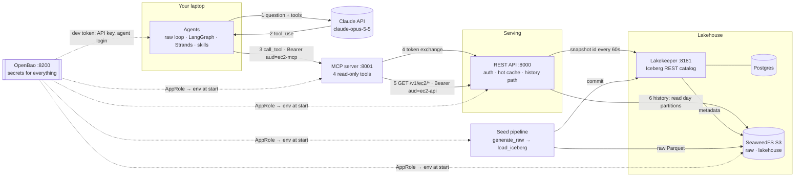

# Architecture

The full diagram with the numbered request trace is [architecture.html](architecture.html) (open it in a browser;
also published at https://claude.ai/artifact/LhZdspwRd18AChjiPyVGtK). This is the same picture as a Mermaid diagram, which renders in VS Code and
GitHub.

1. The agent sends Claude the question and the tool definitions it listed from the MCP server.
2. Claude replies with a tool call (for "largest": `find_instances(sort_by="vcpus", descending=true)`).
3. The agent calls the MCP server with a token meant for the MCP server.
4. The MCP server exchanges it for an API token for the same user (no token passthrough).
5. The API checks scopes and answers from the in-memory latest snapshot.
6. History questions read only the needed Iceberg day partitions from S3.
